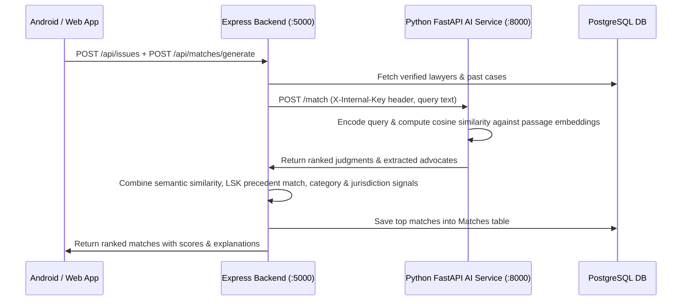

# WakiliMatch AI Matching Service

FastAPI-powered Python retrieval service utilizing SentenceTransformers (`sentence-transformers/all-MiniLM-L6-v2`) and cosine similarity over Kenya case law passages, integrated into the WakiliMatch Express backend.

---

## 1. Quick Start (PowerShell)

### Setup Virtual Environment & Install Dependencies
```powershell
python -m venv .venv
./.venv/Scripts/Activate.ps1
pip install -r requirements.txt
```

### Build the Index (from HuggingFace `MakiniAI/kenya-law-corpus`)
```powershell
python build_index.py
```
*(To build a larger sample or full dataset, use `--max-docs-per-area 500` or omit `--max-rows`.)*

### Run the FastAPI Service
```powershell
python -m uvicorn main:app --host 127.0.0.1 --port 8000 --reload
```

---

## 2. Architecture & Flow Diagram



---

## 3. Environment Variables

### `ai-service/.env`
```env
INTERNAL_API_KEY=wakili-internal-secret-2026
ARTIFACTS_DIR=artifacts
```

### `legalmatch/.env`
```env
MATCHING_ENGINE=ai
AI_SERVICE_URL=http://localhost:8000
INTERNAL_API_KEY=wakili-internal-secret-2026
AI_FALLBACK=true
```

---

## 4. Evaluation & Model Comparison

- **Retrieval Evaluation**: Run `python eval/run_eval.py` to calculate P@5, P@10, MRR, nDCG@10, and grouped cross-validation macro-F1 (saved to `eval/RESULTS.md`).
- **Model Comparison**: Compare TF-IDF, BM25, MiniLM-L6, and hybrid models using `python eval/compare_models.py` (saved to `eval/COMPARISON.md`).

---

## 5. Limitations & Future Work

### Limitations
1. **English-Only**: Version 1 processes English case law. Swahili queries receive an `unsupported_language` prompt.
2. **Corpus Sample**: Default index is built from a laptop-friendly stratified sample of the Kenya Law Corpus (CC BY-NC 4.0). Full production deployment requires a GPU.
3. **Advocate Disambiguation**: Surname-only extracted names (`ambiguous: true`) are flagged and never auto-linked to verified profiles.
4. **Commercial Use**: Corpus license CC BY-NC 4.0 must be reviewed prior to any commercial monetization.

### Future Work (Section 8)
- Fine-tuning MiniLM on case-summary/passage pairs.
- spaCy PERSON-entity extractor comparison.
- Multi-lingual (Swahili) embedding support.
- Automated LSK register verification scraping.
